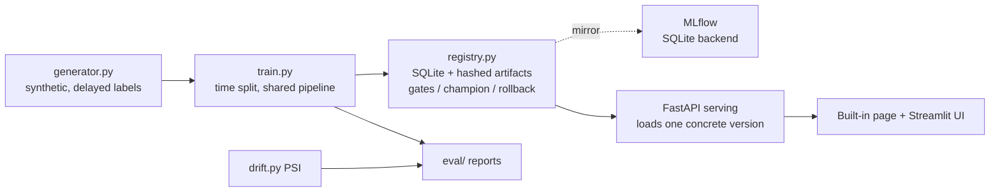

# FraudWatch — Explainable ML Service with Model Promotion

A portfolio classifier that scores **fictional** transactions and shows the
model version and interpretable risk factors behind each decision. It
demonstrates the full MLOps loop: deterministic synthetic data → time-based
training → a model registry with promotion gates → live serving that loads a
concrete version → rollback that provably changes the served version.
**Not a real banking decision service. Synthetic data proves engineering
behaviour, not real fraud-detection effectiveness.**


- **Live (local) demo:** `http://localhost:8023` after the quickstart below
  (built-in page at `/`, OpenAPI at `/docs`)
- **Public URL:** pending — no deployment account authorized; VM route in
  `docs/architecture.md`
- **Screenshot:** `docs/screenshot.txt` (recording pending; the live evidence
  is `eval/http_demo.md` — real HTTP responses, incl. rollback proof)

## Three implemented capabilities

1. **Reproducible training with honest evaluation** — time-based split,
   preprocessing fitted on train only and shared verbatim with serving,
   thresholds chosen on validation, test period used once. XGBoost candidate
   vs logistic baseline, full metrics in `eval/evaluation_report.md`.
2. **Registry with gates, promotion and rollback** — SQLite + filesystem
   registry (MLflow-mirrored), hash-verified artifacts, a demonstrated
   *failed* promotion gate, and rollback where the running server's reported
   `model_version` actually changes (2 → 1 → 2 in `eval/http_demo.md`).
3. **Drift monitoring that doesn't overclaim** — PSI per feature on a
   controlled drift scenario; a detected shift requests review and is
   explicitly *not* treated as accuracy loss (labels arrive 1–14 days late).

## Measured results (committed run, seed 42, n=20,000, prevalence 4.45%)

| model | version | test PR-AUC | precision | recall | FPR | Brier |
|---|---|---|---|---|---|---|
| Logistic baseline | v1 | 0.4204 | 0.4785 | 0.5917 | 0.0285 | 0.1066 |
| **XGBoost candidate (champion)** | **v2** | **0.4571** | **0.5580** | **0.4556** | **0.0159** | **0.0286** |
| Weak amount-only (gate demo) | v3 | 0.1009 | 0.0423 | 1.0000* | 1.0000* | 0.1169 |

*v3 at its validation-F1 threshold flags everything — exactly why its
promotion gate failed on validation metrics (PR-AUC 0.152, FPR 0.063).
Full confusion matrices + calibration: `eval/evaluation_report.json`.
Serving benchmark (200 reqs, localhost): p50 10.27 ms, p95 13.08 ms.

## Quickstart

```bash
python3 -m venv .venv
.venv/bin/pip install -r requirements-dev.txt   # core only; see requirements-optional.txt
.venv/bin/python scripts/run_training.py --n 20000   # data -> train -> register -> promote v2
.venv/bin/python scripts/simulate_drift.py
.venv/bin/uvicorn app.main:app --port 8023
bash scripts/smoke_test.sh   # or: .venv/bin/python scripts/run_http_demo.py http://localhost:8023
.venv/bin/python -m pytest -q   # 7 tests, self-contained
```

Linux commands shown; on Windows PowerShell use `.venv\Scripts\...` equivalents.
Optional Streamlit UI: `pip install -r requirements-ui.txt && streamlit run ui/streamlit_app.py`.

## API

| Endpoint | Purpose |
|---|---|
| `GET /healthz` / `GET /readyz` | liveness / readiness (503 if no model loaded) |
| `GET /metrics` | request/error counts, p95 latency, loaded version |
| `GET /api/model` | loaded version, kind, threshold, validation metrics, fingerprint |
| `POST /api/predict` | `{request_id, score, threshold, decision, model_version, explanation}` |
| `POST /admin/reload` / `POST /admin/rollback` | token-gated; reload champion / roll back + reload |

Example predict response (real, from `eval/http_demo.md`): score **0.985**,
decision **fraud**, model_version **2**, signals: country mismatch + velocity,
amount above customer median, new device at higher-risk merchant.

## Architecture



More: `docs/architecture.md` · `docs/demo.md` · `docs/decisions.md` ·
`docs/model_card.md` · `docs/verification.md` · `data/DATA_CARD.md`

## Limitations & tradeoffs

- Synthetic data only; metrics say nothing about real fraud performance.
- Explanations are global permutation importance + row-level rule signals —
  non-causal. SHAP is an optional dependency (not installed in the build
  environment); see `docs/decisions.md`.
- The registry implements MLflow-equivalent version/champion semantics in
  SQLite; runs are also logged to MLflow when installed (they were, in the
  build environment — MLflow 3.17.2, local SQLite backend).
- Docker Compose is provided as configuration; Docker was not available in
  the build environment, so containers were not executed there.

## Resume bullets (personal project, from demonstrated results only)

- Built an end-to-end fraud-scoring service (FastAPI + XGBoost) on 20k
  synthetic transactions with time-based evaluation: champion PR-AUC 0.457 /
  precision 0.558 on an untouched test period vs 0.420 for a logistic baseline.
- Implemented a model registry with hash-verified artifacts, promotion gates
  (a weak candidate was rejected on validation PR-AUC/FPR), and rollback
  verified live over HTTP — served model version changed 2 → 1 → 2.

MIT license. Cleanup: `rm -rf artifacts data/transactions.csv mlflow.db` and stop the server.
